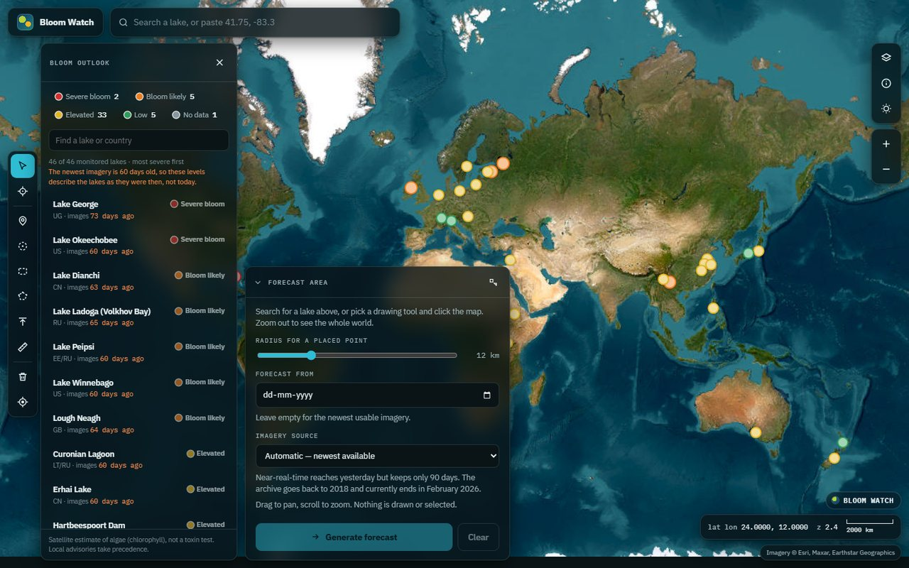
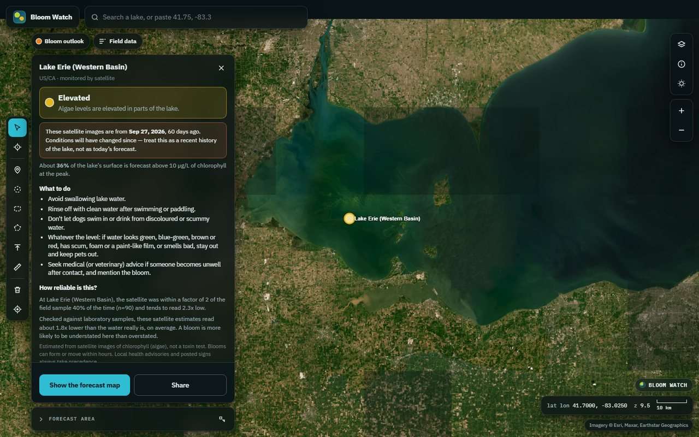
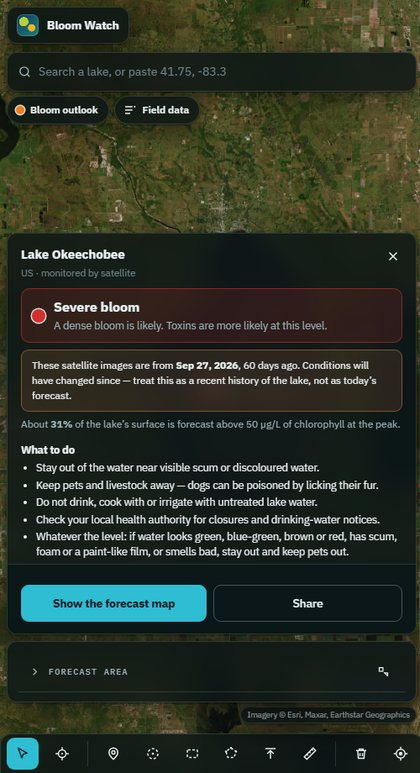
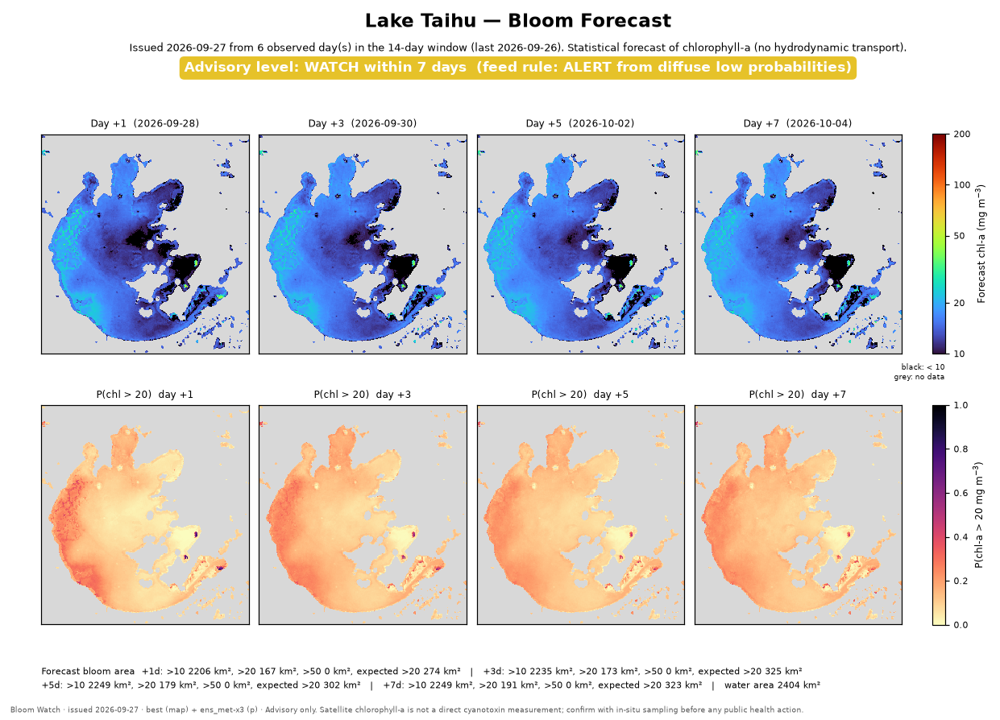
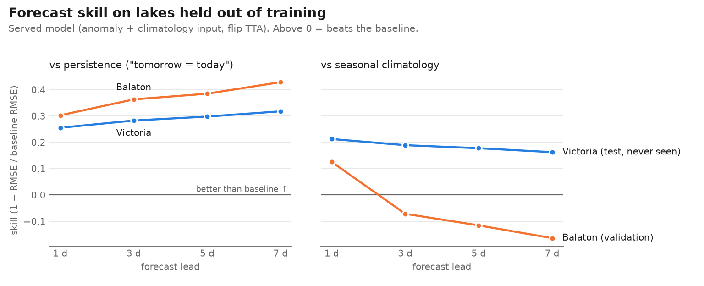
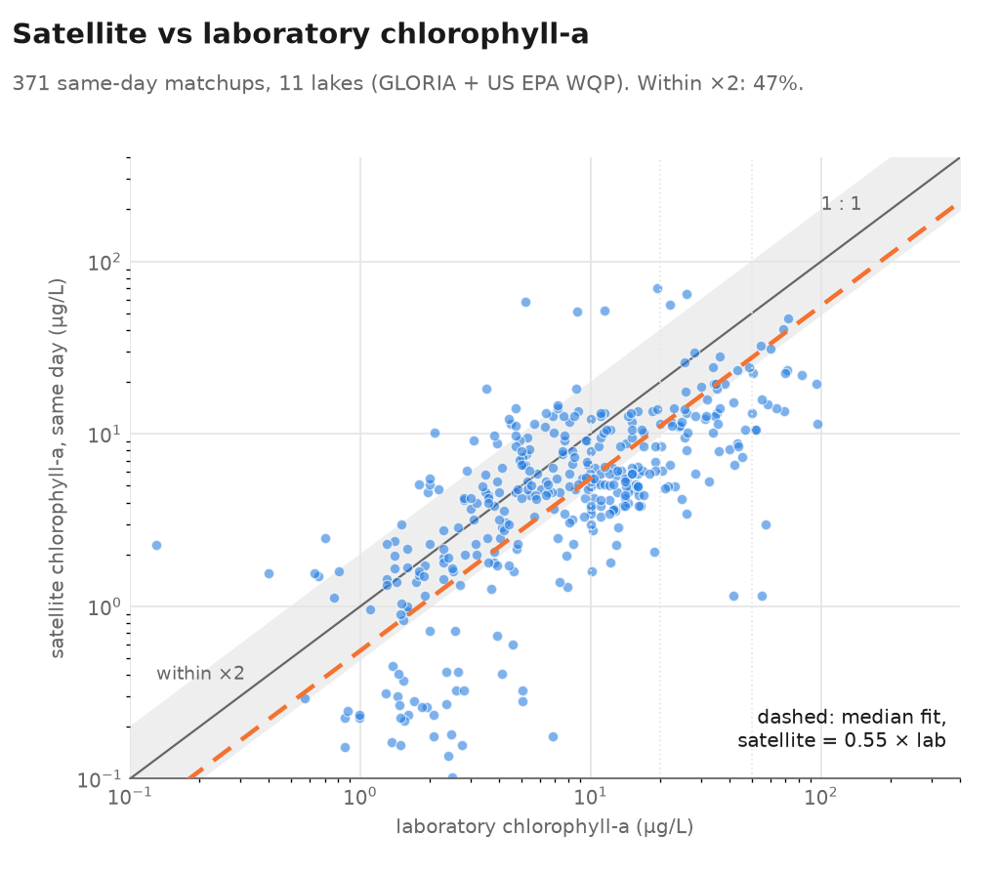
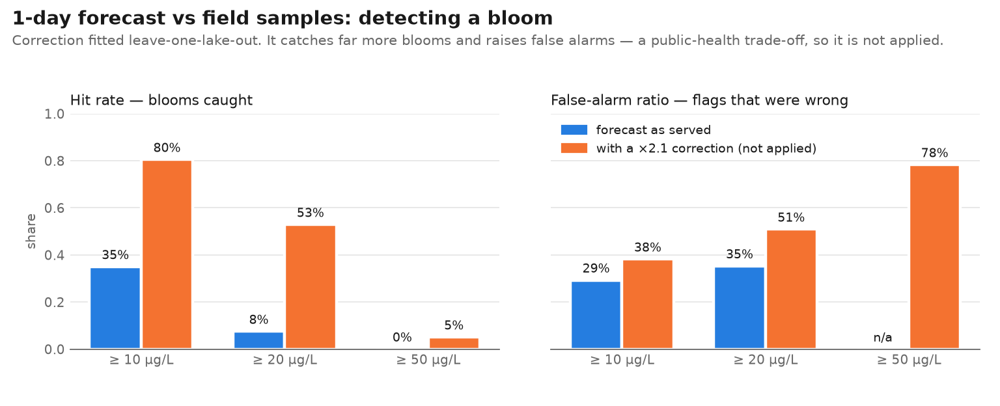
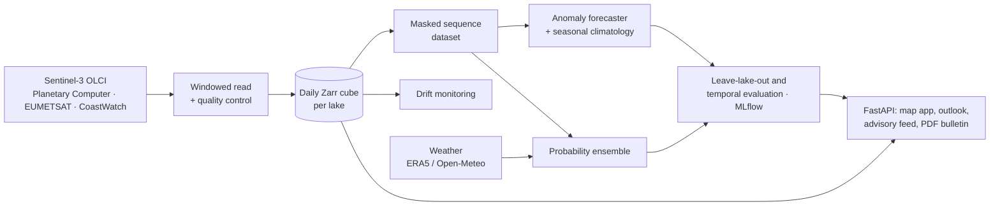
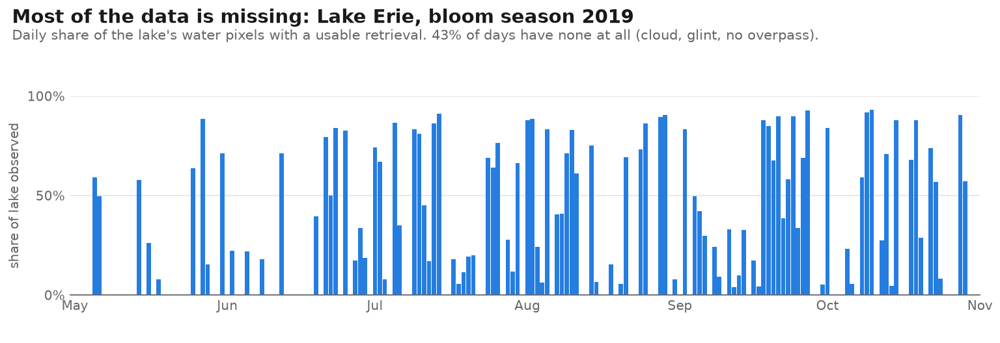
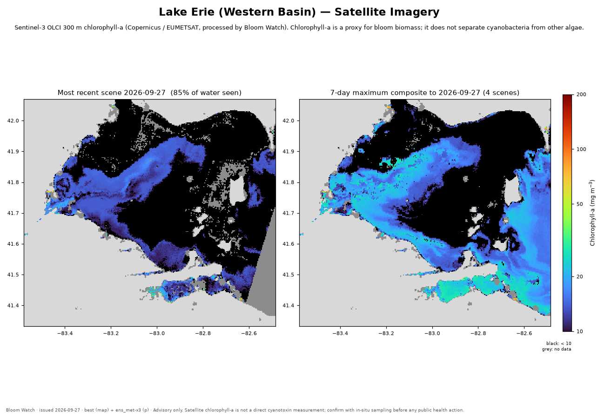

# Bloom Watch

**Short-range forecasts of harmful algal blooms in lakes, from Sentinel-3 satellite imagery —
with a plain-language outlook for the public and an honest error bar for everyone else.**



Most satellite bloom tools *map* what already happened. Bloom Watch forecasts 1–7 days
ahead, is scored on lakes it never saw in training, and is checked against laboratory
water samples — including where that check goes badly.

> **Advisory only.** Satellite chlorophyll-a measures algae, not toxins. Local health
> advisories always take precedence. See [`docs/MODEL_CARD.md`](docs/MODEL_CARD.md).

The Python package is `habforecast` (`src/habforecast/`); Bloom Watch is the project, the
API and the map app built on it.

**Contents** ·
[At a glance](#at-a-glance) ·
[What you can do with it](#what-you-can-do-with-it) ·
[How good is it?](#how-good-is-it) ·
[How it works](#how-it-works) ·
[Quickstart](#quickstart) ·
[Configuration](#configuration) ·
[Repository layout](#repository-layout) ·
[Limitations](#limitations)

---

## At a glance

| | In short |
|---|---|
| **Coverage** | 46 monitored lakes on 6 continents (`data/aoi/lakes_global.geojson`); any other lake, reservoir or bay can be drawn on the map |
| **Forecast** | Chlorophyll-a at 300 m, 1, 3, 5 and 7 days ahead, plus advisory levels at 10 / 20 / 50 µg/L |
| **Skill on a lake never seen in training** (Victoria) | +0.26 → +0.32 against persistence and +0.16 → +0.21 against a seasonal climatology, across leads 1–7 days |
| **Checked against 1,800 laboratory samples** | The satellite ranks waters well (rank correlation 0.70) but **reads ~1.8× low**, so blooms are under-called. [Details](#against-laboratory-water-samples) |
| **Speed** | Outlook for all lakes in 0.2 s; any area inside a monitored lake in a few seconds, from stored data; a repeated live request read from disk |
| **Runs on** | A laptop: trained on a 4 GB RTX 3050; serves on CPU, or on ONNX with no PyTorch at all |

## Why this matters

Cyanobacterial blooms cut off drinking water for 400,000 people in Toledo, Ohio, in 2014.
They close beaches, kill fish and poison pets and livestock. Lake Taihu supplies water to
about 10 million people and blooms every summer; Lake Victoria supports about 40 million.

Monitoring is mostly reactive: a bloom is sampled after someone sees it. Sentinel-3 OLCI
observes every lake larger than a few km² daily, at 300 m, for free, with bands designed
for exactly this. The gap is not data. It is a forecast with an honest error bar, said in
words a person deciding whether to take the dog to the lake can use.

---

## What you can do with it

### Check a lake

`/app` opens on the **Bloom outlook**: every monitored lake as a coloured marker —
**Low**, **Elevated**, **Bloom likely** or **Severe** — and a list sorted most severe
first. A lake's card says, in plain words:

- how worried to be, and what to do about it (it never says "safe to swim");
- **how old the satellite images are** — imagery older than 10 days is flagged on the
  marker, in the list and on the card;
- how the satellite compared with laboratory samples at that lake, where any exist.

`#lake=<id>` links share a lake directly. Levels are the advisory's own, held inside their
likely…possible probability band (`habforecast.outlook`), so the map, the PDF bulletin and
the feed never disagree.

<p align="center">
  
  &nbsp;
  
</p>

### Forecast any water body

Search for a place or draw a point, circle, rectangle or polygon (or upload GeoJSON, KML
or a shapefile) and the app forecasts it. **Stored data is used whenever it can answer**
(`habforecast.stored`): an area lying inside one of the 46 monitored lakes is forecast
from that lake's archive, clipped to your shape, in a few seconds — however the area was
chosen. Otherwise a fortnight of imagery is fetched, and every scene fetched is kept, so
asking for the same area again reads it from disk (`data/scene_cache.py`). Before anything
runs, the app shows which data and which model it will use, and why:

| Water selected | Imagery | Model |
|---|---|---|
| Any area inside a monitored lake, when its archive holds the date asked for | The lake's ingested archive, clipped to the area (nothing downloaded) | 300 m checkpoint **with** the lake's seasonal climatology |
| Any other inland lake, or coastal water within 40 km of shore | Sentinel-3 OLCI 300 m (CHL_NN), near-real-time | 300 m no-history checkpoint; the 750 m one offered where the area is ≥ 16 px at 750 m |
| Open ocean beyond the shelf | VIIRS / OLCI 4 km | **None** — a labelled persistence baseline |

"When its archive holds the date" matters: asked for the newest imagery while the
archive is more than 10 days old, the app downloads instead of quietly returning an old
forecast, and the panel says which date to pick for the instant answer. Areas answered
from stored data are not subject to the 80 km limit for downloaded areas.

The 750 m checkpoint is the better forecaster, but its band-ratio retrieval masks turbid
inland water (2.6% valid pixels on Taihu), and turbid inland water is what this tool is for.
The 4 km checkpoint scored *negative* skill, so the open ocean gets imagery and a baseline
rather than a measured non-result dressed as a forecast. Every marine route says that no
checkpoint here was trained on marine water.
[More in docs/DATA_SOURCES.md](docs/DATA_SOURCES.md#choosing-the-product-and-the-model-for-the-water-selected).

The **inspect** tool reads the forecast under a click at every lead, plots the fortnight of
satellite data behind it, and shows any field measurements within 10 km.

### Download a bulletin

Any forecast can be downloaded as an NCCOS-style PDF bulletin: satellite imagery, the
forecast by lead, exceedance probabilities, and the wind-mixing and scum-risk outlook.
`scripts/make_bulletin.py` produces one for every monitored lake.



### Use the API

Interactive documentation is at `/docs`; every route is listed there and below.

| Endpoint | Returns |
|---|---|
| `GET /app` | The map app: outlook, drawing tools, forecasts, bulletins |
| `GET /` | A minimal single-lake forecast viewer, no JavaScript build |
| `GET /api/outlook` | Every monitored lake's level in plain language, image age, advice |
| `GET /lakes` | The monitored lakes: names, split, extent, archive length |
| `GET /forecast?lake_id=…` · `GET /forecast/image` | One lake's forecast (JSON) and map overlay (PNG) |
| `GET /advisory` · `GET /advisory/feed.xml` | The advisory feed as GeoJSON and RSS |
| `POST /api/forecast/jobs` → `GET /api/forecast/jobs/{id}` | A forecast for any area, run as a background job; answered from stored data when an archive covers it (`lake_id` asks for a whole monitored lake) |
| `GET /api/forecast/jobs/{id}/bulletin.pdf` | The PDF bulletin for a finished job |
| `GET /api/route` · `GET /api/models` | Which data and model a box (and optional `anchor` date) would use, and why — including whether stored data answers; every checkpoint with its measured skill |
| `GET /api/places` · `POST /api/geometry` | Place search (gazetteer, then OpenStreetMap Nominatim); read an uploaded GeoJSON, KML or shapefile |
| `GET /api/validation-summary` | The comparison with laboratory samples |
| `GET /api/insitu` · `GET /api/validation-sites` | Field measurements near a point; water bodies that have them |
| `GET /model-card` · `GET /dashboard` | The model card; the results dashboard |
| `GET /health` · `GET /metrics` · `GET /api/jobs/stats` | Health check, Prometheus metrics, background-job counts |

---

## How good is it?

Every number below is regenerated from the project's own outputs; the figures come from
`scripts/make_readme_figures.py`.

### Against the satellite, on lakes held out of training

**Split by lake, never at random.** A random split would put 14 July 2019 on Lake Erie in
training and 15 July in validation; they share most of their pixels, so the score would
measure memorisation. Holding out whole lakes answers the question a user actually has:
*will this work on my lake?*

| Split | Lakes | Why |
|---|---|---|
| train | Erie (western basin), Okeechobee, Taihu | Temperate and subtropical, all hypereutrophic |
| validation | Balaton | Narrow, elongated basin — a different shape |
| **test** | **Victoria (Winam Gulf)** | **Tropical, no seasonal cycle, another continent** |

**Always against both baselines.** Persistence ("tomorrow looks like today") is strong at
1 day and fades; a seasonal climatology is weak at 1 day and does not fade. A model has to
beat both to be worth running.



- **The test lake generalises.** On Victoria the model beats persistence by +0.26 → +0.32,
  growing with lead as it should, and beats climatology at every lead.
- **Balaton loses to climatology after day 1.** It is mesotrophic with a strong, stable
  seasonal cycle, so its own climatology is already a very good forecast, and the model is
  only allowed part of the way toward it.
- **Ranking extremes is the weak point.** PR-AUC for "exceeds 20 µg/L" is only level with
  persistence on Victoria (0.616 vs 0.611 at 1 day). The model cuts error everywhere but
  does not pick out the bloomiest pixels much better than yesterday's image.
- **The climatology input does the work.** Without it the same network scores −0.003 →
  +0.033 against persistence — about persistence. A drawn area has no archive to build one
  from, so it gets the earlier no-history checkpoint (+0.046 → +0.062), and the app says so.

<details>
<summary>Full scores by lake and lead, and the temporal split</summary>

Served model: `anomaly` forecaster with the lake's seasonal climatology as an input
(`conf/model/anomaly_clim.yaml`, 0.34 M parameters, 1,475 training samples), scored with
flip test-time augmentation. Regenerate with `make evaluate results`.

| Lake | Split | Lead | RMSE (log₁₀) | vs persistence | vs climatology | POD @20 | FAR @20 | CSI @20 | PR-AUC @20 (model / persistence) |
|---|---|---:|---:|---:|---:|---:|---:|---:|---:|
| Balaton | val | 1 d | 0.309 | +0.303 | +0.125 | 0.020 | 0.436 | 0.020 | 0.149 / 0.099 |
| Balaton | val | 3 d | 0.350 | +0.363 | −0.072 | 0.017 | 0.537 | 0.017 | 0.110 / 0.082 |
| Balaton | val | 5 d | 0.349 | +0.385 | −0.116 | 0.007 | 0.803 | 0.007 | 0.073 / 0.069 |
| Balaton | val | 7 d | 0.368 | +0.429 | −0.164 | 0.006 | 0.570 | 0.006 | 0.116 / 0.082 |
| Victoria | **test** | 1 d | 0.241 | +0.255 | +0.213 | 0.316 | 0.198 | 0.293 | 0.616 / 0.611 |
| Victoria | **test** | 3 d | 0.242 | +0.283 | +0.189 | 0.287 | 0.249 | 0.262 | 0.576 / 0.571 |
| Victoria | **test** | 5 d | 0.246 | +0.298 | +0.178 | 0.288 | 0.283 | 0.259 | 0.544 / 0.545 |
| Victoria | **test** | 7 d | 0.248 | +0.318 | +0.163 | 0.289 | 0.295 | 0.258 | 0.541 / 0.545 |

A second split keeps every lake but holds out *years* (train 2018–2022, validate 2023, test
2024–2025; `data.split_mode=temporal`). Mean skill over test lakes:

| Lead | New lake: vs persistence | New lake: vs climatology | New year: vs persistence | New year: vs climatology |
|---:|---:|---:|---:|---:|
| 1 d | +0.255 | +0.213 | +0.301 | +0.190 |
| 3 d | +0.283 | +0.189 | +0.444 | +0.314 |
| 5 d | +0.298 | +0.178 | +0.345 | +0.311 |
| 7 d | +0.318 | +0.163 | +0.470 | +0.369 |

The gap between the columns is what a lake outside the training set costs. Full tables,
including ROC-AUC and PR-AUC at every threshold, are in [`docs/MODEL_CARD.md`](docs/MODEL_CARD.md).

</details>

### Against laboratory water samples

Scoring against the satellite measures forecasting skill, but not whether the numbers mean
anything in the water. `scripts/validate_insitu.py` compares both the satellite retrieval
and the forecast with **laboratory chlorophyll-a** that no part of training saw: GLORIA
(PANGAEA, CC-BY 4.0) and the US EPA Water Quality Portal. Method: 3×3-pixel medians at
300 m, replicate samples merged, errors in log₁₀, 95% intervals by bootstrap over
lake-days. Run 2026-11-26 on the served model, 17 lakes with samples, 7 minutes.

<p align="center">
  
</p>

| | n | within ×2 of the sample | typical error | vs "repeat the last image" | vs seasonal mean |
|---|---:|---:|---|---|---|
| Satellite, same day | 371 | 47% | ×2.4, reads **~1.8× low** | — | — |
| Forecast, 1 day | 1,156 | 39% | ×2.6 | **+0.08** [0.05, 0.12] | **−0.13** [−0.17, −0.10] |
| Forecast, 7 days | 1,144 | 40% | ×2.5 | **+0.14** [0.11, 0.18] | **−0.09** [−0.13, −0.06] |

- **The satellite reads low.** It orders waters well but on average reports 0.55× the
  laboratory value (Lake Geneva ~8× low). Because the 10 / 20 / 50 µg/L thresholds are
  applied on that low scale, **blooms are under-called**.
- **The forecast holds its ground against persistence** against real water, as it does
  against the satellite, and **still loses to the seasonal mean** — the same pattern.
- **A correction would help, at a price.** One multiplicative factor, fitted for each lake
  on the *other* lakes only (×2.1), raises the share of 20 µg/L blooms caught from 8% to
  53%, while the share of its flags that are false alarms rises from 0.35 to 0.51. It is **not applied**: moving
  public thresholds is a public-health decision, not a tuning step. Until then, the app
  tells every visitor that a bloom is more likely understated than overstated.



Outputs are `artifacts/insitu_validation/{summary.json, matchups.csv.gz}`, served at
`/api/validation-summary` and shown in the app. `--from-matchups` rebuilds the summary in
seconds without re-running the forecasts.

### What has been tried since, and what is next

The served map model is the one scored above. Experiments since then, none promoted for the
map (promotion is a deliberate human decision; `scripts/promotion_gate.py` only advises):

- **An exceedance head** (a classifier per advisory level) gave no ranking gain on its own.
- **Weather inputs** (ERA5 via Open-Meteo, a 3-seed ensemble, `models/ens_met`) improve
  PR-AUC @20 over persistence by 0.04–0.06 on Victoria. This ensemble supplies the
  advisory's **probabilities**.
- **A 46-lake multilevel model** (`models/ens_global_ml`, with trophic, thermal and continent
  embeddings) passes the promotion gate against `ens_met`. Against the 15-lake ensemble it
  improves skill and R² but fails on PR-AUC @20 at 3 and 7 days by more than the 0.01
  tolerance (`artifacts/gate_global_*`).

Next: calibrate thresholds against field samples (the decision above), bloom-type spectral
layers (`ci`, `pc620`, `adg443` in `data/aux_layers.py`, built but never trained on), and
altitude-aware atmospheric correction for high lakes such as Titicaca.

---

## How it works



| Layer | Choice | Why |
|---|---|---|
| Data | Planetary Computer STAC (anonymous), EUMETSAT Data Store, NOAA CoastWatch | No credentials needed to reproduce; near-real-time where it exists |
| Storage | Zarr, one cube per lake | Chunked and appendable, ~0.08 MB per lake-day |
| Training | PyTorch Lightning, Hydra configs, MLflow tracking, DVC for data | Sweeps, full run history, reproducible cubes |
| Serving | FastAPI, a hand-written map (no CDN dependencies), optional ONNX backend | Runs offline in a container; ONNX image ships without PyTorch |
| Scheduled job | `pipelines/advisory.py` | Daily advisories to disk, same code as the live endpoint |
| Monitoring | `monitoring/drift.py` | Observation, distribution and **geographic** drift |
| CI | GitHub Actions | Lint, the unit tests (including docs-in-sync checks), config contracts, image build, API smoke test |

### Most of the data is missing



Across the archive (2018–2025, bloom season only):

| Lake | Daily frames | Grid | Water px | Bloom-season days with data | Per-pixel density | Median chl-a | P90 |
|---|---:|---:|---:|---:|---:|---:|---:|
| Erie (W. basin) | 540 | 267×298 | 42,895 | 44.3% | 51.9% | 4.1 | 10.6 |
| Okeechobee | 735 | 212×180 | 14,941 | 43.2% | 47.0% | 25.2 | 50.2 |
| Taihu | 492 | 266×252 | 25,524 | 29.0% | 36.8% | 14.1 | 22.6 |
| Balaton | 399 | 166×260 | 5,931 | 41.5% | 54.8% | 6.4 | 13.6 |

Roughly 3 in 5 observations do not exist, and the gaps cluster around the storms that also
drive blooms. That shapes every design decision:

- Frames sit on a **regular daily calendar**, so a 3-day gap and a 30-day gap look different.
- Every sample carries **explicit mask channels**: the model is told what to trust.
- The **loss is normalised by the mask**, not the tensor size; otherwise the optimiser
  would learn that shrinking toward zero is the cheapest way to reduce a mostly-cloudy loss.
- The model **predicts a change from the last observed value**, so persistence is the
  default and any departure from it has to be earned. The served model also blends that
  anchor toward the lake's seasonal climatology, by a learned weight.

<p align="center">
  
</p>

### Three findings worth reading

Each is pinned by a regression test.

**1. The obvious quality mask deletes 100% of the data.** OLCI's `WQSF` flags behave
counter-intuitively over lakes. On a real Lake Erie granule `WATER` is set on **0.00%** of
pixels (it is an open-ocean flag) while `LAND` is set on 75.85% — including inland water.
The textbook mask (require `WATER`, reject `LAND`) returns nothing; the first ingest here
did exactly that. Correct: **require `INLAND_WATER`, do not reject `LAND`**.

**2. Two more flags correlate with blooms, and rejecting them biases the data.**
`TURBID_ATM` (22.8%) and `OC4ME_FAIL` (7.0%) are commonly rejected. Surface scum trips the
turbid-atmosphere test, and the open-ocean algorithm always fails in turbid water — which is
why `CHL_NN` is read instead. Rejecting them preferentially deletes the strongest blooms;
both are kept, and [`STRICT_REJECT_FLAGS`](src/habforecast/data/qc.py) measures the difference.

**3. The ingest looks I/O-bound and is not.** Scene reads are HTTP range requests, so
threads are the obvious choice — but HDF5 calls and decompression hold the GIL (effective
concurrency ~1.2 with 24 threads). Processes cut per-scene time from 5.8 s to 3.4 s.
Locating the lake through the tie-point grid and range-reading only intersecting chunks
reads **0.1% of a granule**, and running quality control before the 61 MB geolocation read
rejects about half of scenes before the expensive step.

### Serving speed

Measured 2026-11-26 on the development laptop:

| | Before | After |
|---|---|---|
| First forecast after a restart | ~27 s | warmed in the background at startup |
| A lake not yet loaded | 1.5–4.5 s | 0.4–1.1 s |
| Forecast map for a monitored lake | 17 s+ (satellite download) | **~1 s** (from its archive) |
| A shape drawn inside a monitored lake (date in the archive) | minutes (25 scene downloads) | **~4 s**, clipped to the shape |
| Repeating a live (downloaded) request | the same minutes again | scenes read from disk |
| Outlook for 46 lakes after a restart | ~60 s | **0.2 s** (cached on disk; rebuilt only when data change) |

The time went to importing Lightning on the first forecast (15 s; serving now imports only
`models.forward`), and to two whole-archive calculations per lake: the water mask (now cached
on disk, keyed by the cube's signature) and the climatology (now one read for all four leads).

---

## Quickstart

```bash
git clone https://github.com/<your-account>/bloom-watch.git
cd bloom-watch
```

### Docker (recommended)

```bash
make build
make mlflow       # tracking UI on :5000
make ingest       # build Zarr cubes (~2-3 h, resumable)
make train        # GPU training; needs the NVIDIA Container Toolkit
make api          # app, API and dashboard on :8000 — open /app
```

GPU training in a container needs the NVIDIA Container Toolkit (on Windows, Docker Desktop
with the WSL2 backend). Without it `--gpus all` is silently ignored, so
`docker/Dockerfile.gpu` prints its CUDA build at image-build time.

### Conda

```bash
conda env create -f environment.yml
conda activate hab
bash scripts/install_torch.sh          # CUDA wheel, then asserts torch.cuda.is_available()
pip install -e ".[all]"

python pipelines/ingest.py --start 2018-01-01 --end 2024-12-31 --workers 12
python pipelines/train.py                                   # leave-lake-out
python pipelines/train.py data.split_mode=temporal          # the second split
python pipelines/evaluate.py --checkpoint models/best.ckpt --out artifacts/eval --tta
python pipelines/advisory.py                                # today's GeoJSON + RSS
python scripts/validate_insitu.py                           # check against field samples
python scripts/make_readme_figures.py                       # the figures in this README
uvicorn serving.api.main:app --port 8000                    # then open /app
```

Python 3.11 or 3.12 (Hydra 1.3 cannot parse arguments on 3.14; see `docs/SETUP.md`).
PyTorch is deliberately not in `environment.yml`: an `--extra-index-url` in a pip block
still resolves to the CPU-only wheel on PyPI, and you silently train on CPU.

### Running on 4 GB of VRAM

Developed and trained on an RTX 3050 Laptop (4 GB). Lake grids are small (the largest is
370 × 351 at 300 m); training uses 128 × 128 random crops, mixed precision and gradient
accumulation (effective batch 16 from 8); models are under 3 M parameters; observations are
cached as float16. The global 46-lake training reads memory-mapped cubes (`+paths.mmap=…`).

---

## Configuration

Every setting has a working default.

**The API** (`serving/api/main.py` and the modules it calls):

| Variable | Default | Purpose |
|---|---|---|
| `HAB_AOI` | `data/aoi/lakes.geojson` | Lake registry (`lakes_global.geojson` for all 46) |
| `HAB_CUBES` | `data/processed/cubes` | Zarr cubes, one per lake |
| `HAB_CHECKPOINT` | `models/best.ckpt` | Map model: a `.ckpt`, an ensemble folder or an ONNX export |
| `HAB_PROB_CHECKPOINT` | `models/ens_met` | Advisory probability model; if missing, the advisory thresholds the map |
| `HAB_MET_ROOT` | `<cubes>/../met` | Weather for the probability model (`data/processed/met_live` for current dates) |
| `HAB_MODEL_ROOT` | `models` | Where routed checkpoints are looked up inside a container |
| `HAB_TTA` | `1` | Average each forecast over four flips |
| `HAB_INSITU` | `data/validation/insitu.csv.gz` | Field-measurement index (`scripts/build_insitu_index.py`) |
| `HAB_ARTIFACTS` | `artifacts` | Where the validation summary and evaluation results are read from |
| `HAB_STATIC_CACHE` | `data/cache/statics` | Per-lake water masks kept between restarts (empty disables) |
| `HAB_OUTLOOK_CACHE` | `data/cache/outlook.json` | The built outlook, kept between restarts |
| `HAB_SCENE_CACHE` | `data/cache/scenes` | Scenes downloaded for live requests, kept for repeats (empty disables) |
| `HAB_SCENE_CACHE_MB` | `2048` | Size cap for that cache; least recently used scenes go first |
| `HAB_WARMUP` | `1` | Load the model and build the outlook at startup (`0` disables) |
| `HAB_HTTP_CACHE` | `data/cache/erddap` | Cached CoastWatch responses (a past fortnight does not change) |
| `HAB_COAST_REFERENCE` | `data/reference/ne10_ocean.npz` | Ocean polygon the water classifier reads |
| `HAB_GEOCODER` | `on` | Place search falls back to OpenStreetMap Nominatim (`off` keeps it offline) |
| `HAB_GEOCODER_URL` | Nominatim's public endpoint | A self-hosted geocoder instead |

**Training and scheduled jobs:**

| Variable | Default | Purpose |
|---|---|---|
| `HAB_CLIM_CACHE_MB` | `2048` | Memory budget for the training climatology cache; lower it on a small machine |
| `HAB_ALERT_WEBHOOK` | unset | Slack-compatible webhook `pipelines/advisory.py` posts new alerts to |

Credentials are never read from the repository: the EUMETSAT Data Store uses
`eumdac set-credentials`, Earthdata (PACE) a `~/.netrc` entry, and both are optional.

---

## Repository layout

```text
src/habforecast/
  aoi.py                  per-lake analysis grid (deterministic, UTM)
  data/                   OLCI reader and quality control, resampling, Zarr store, ingest,
                          EUMETSAT / CoastWatch / PACE sources, weather, auxiliary layers,
                          scene_cache.py (downloaded scenes kept for repeats)
  features/               masked sequence dataset; leave-lake-out and temporal splits
  models/anomaly.py       the served forecaster (persistence-anchored, climatology blend)
  models/forward.py       how a model is called, and flip averaging (torch only)
  models/lit.py           training: masked Huber loss, per-lead skill logging
  models/convlstm.py      ConvLSTM and U-Net controls; baselines.py: persistence, climatology
  eval/metrics.py         regression and event scores, ROC/PR-AUC, skill — all streaming
  eval/matchup.py         scoring against laboratory samples
  inference/              cube-backed and live forecasts, ad-hoc areas, ONNX backend
  advisory.py             forecasts → advisory levels → GeoJSON and RSS
  outlook.py              advisory → plain-language public outlook
  stored.py               which monitored lake's archive can answer a requested area
  bulletin.py             PDF bulletin pages
  water.py · routing.py   what kind of water, and which data and model to use
  insitu.py               field measurements near a point
pipelines/                ingest, train, evaluate, monitor, advisory (CLIs)
serving/api/              FastAPI app;  serving/web/  map app (map.js, app.js, chart.js)
monitoring/drift.py       observation, distribution and geographic drift
scripts/                  validation, bulletin, figures, calibration, promotion gate, ONNX export
docs/                     model card, data sources, setup, validation data, img/
conf/                     Hydra configuration
tests/                    unit tests (incl. docs-in-sync checks) and live-network integration tests
```

---

## Limitations

Stated plainly, because a model card that lists only strengths is not a model card.

- **Chlorophyll-a is a proxy.** It does not separate cyanobacteria from harmless algae and
  it is not a toxin measurement.
- **The model forecasts what the satellite sees**, as NOAA's Lake Erie bulletin does.
  Field samples are a check, not a training target, and the check shows the satellite
  reading ~1.8× low ([above](#against-laboratory-water-samples)). Field data is sparse: most
  samples are from US lakes, and GLORIA ends in 2022.
- **Optical retrieval fails** under thick cloud, sun glint and high sun angles, in very
  shallow water, and on very high lakes (Titicaca, 3,810 m: every scene fails the standard
  atmospheric correction).
- **The training set is small.** 29–44% of bloom-season days carry any usable scene, and
  the served map model was trained on three lakes.
- **The geographic-novelty check is under-powered.** It cannot yet tell tropical Victoria
  (0.89) from temperate Balaton (0.86); one of its components (`seasonal_amplitude`,
  0.080 vs 0.126) can.
- **Imagery age varies by source.** The Planetary Computer mirror lags real time by 6–7
  months and starts in 2018; near-real-time forecasts come from EUMETSAT and NOAA
  CoastWatch instead. CoastWatch composites arrive pre-masked and do not name their
  retrieval algorithm, so this project's own quality control does not apply to them. Every
  result states which source served it.
- **The public outlook is only as current as the last data refresh**
  (`artifacts/bulletin/refresh_global_live.sh`), and says so when it is not.

---

## License

Apache-2.0. Sentinel-3 data © Copernicus / ESA, free and open. GLORIA © its authors, CC-BY 4.0.
Basemap imagery © Esri, Maxar, Earthstar Geographics. Not affiliated with ESA, EUMETSAT,
NOAA or Microsoft.
